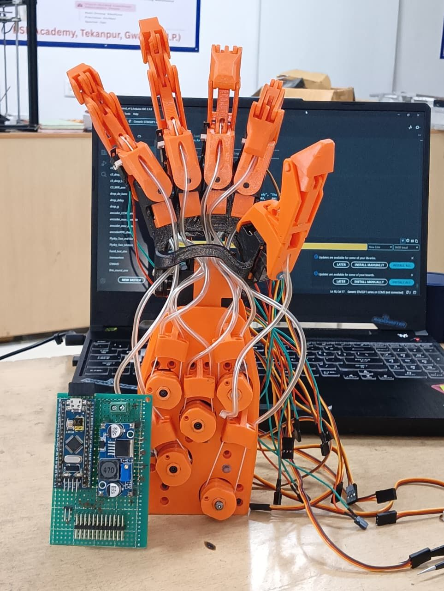
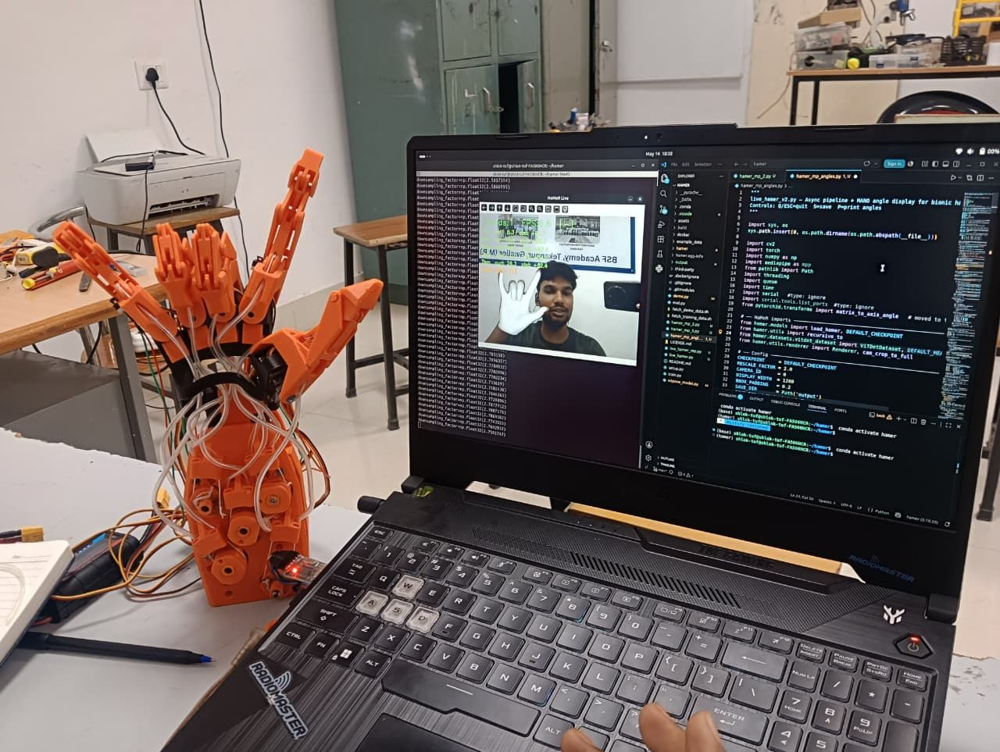
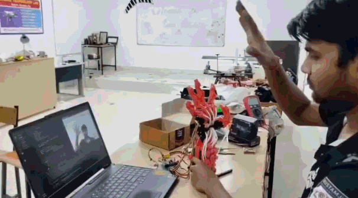
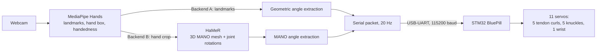
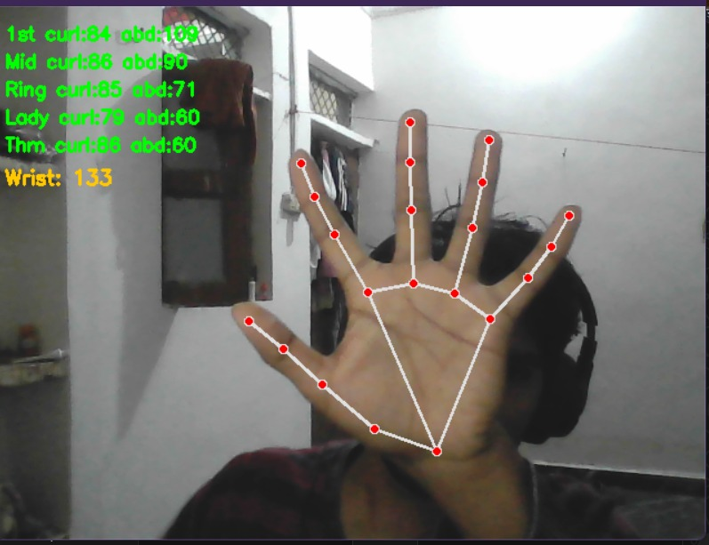
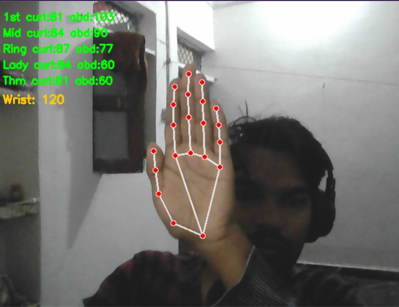
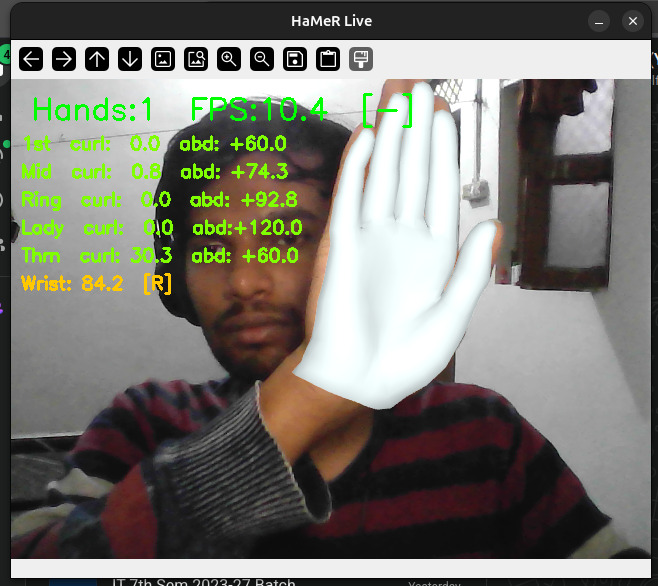
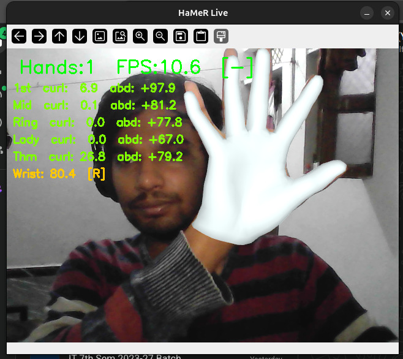
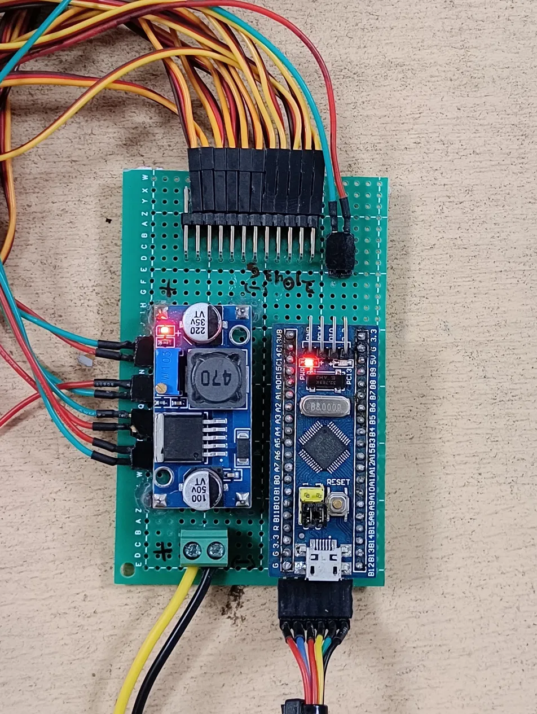
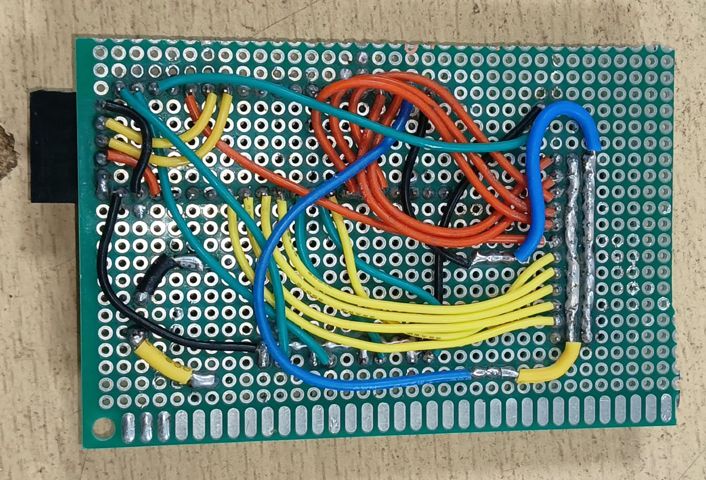

# Bionic Hand

A 3D-printed, tendon-driven robotic hand that mirrors your hand in real time from a single webcam. No gloves, no markers, no manual input: you move your hand in front of the camera and the bionic hand follows.

<p align="center">
  
  
</p>

The laptop does the vision work and the STM32 does the actuation. There are two interchangeable control backends, a lightweight MediaPipe-only one and a heavier MediaPipe + [HaMeR](https://github.com/geopavlakos/hamer) one that reconstructs a full 3D hand mesh. Both send the same serial packets, so the same firmware runs either one.

<p align="center">
  
</p>

## How it works



### Two control backends

| | MediaPipe only | MediaPipe + HaMeR |
|---|---|---|
| Script | `pc/mediapipe_control.py` | `pc/hamer_control.py` |
| Hand representation | 21 landmarks | 3D MANO mesh with per-joint rotations |
| Hardware needed | Any laptop with a webcam | CUDA GPU (tested on an RTX 3050 Mobile, 4 GB) |
| Speed | Real time | 6-7 FPS |
| Curl accuracy | Good, slightly less accurate | Better |
| Abduction (finger spread) | Weakest part | Noticeably stronger |

I built the MediaPipe version first, then moved to HaMeR because MediaPipe struggles with abduction and adduction (the lateral spread of the fingers), where HaMeR is clearly better.

<p align="center">
  
  
</p>
mediapie hands

<p align="center">
  
  
</p>
Hamer

*Computed angles at the least and most abducted hand pose.*

### Getting HaMeR to run live on a 4 GB GPU

Out of the box, HaMeR processed one frame every 3-4 seconds on this machine. It now runs at 6-7 FPS. The changes that got it there:

- **MediaPipe replaces the detection stack.** HaMeR's default Detectron2 + ViTPose hand detection is swapped for MediaPipe bounding boxes, which are far cheaper.
- **Async pipeline.** Capture and MediaPipe run in their own thread and feed a size-1 queue, so HaMeR always works on the newest frame and stale frames are dropped.
- **Half precision.** The ViT-H backbone runs in fp16 with autocast to fit in 4 GB of VRAM.
- **Throttled serial output.** Packets go out at 20 Hz regardless of inference speed.

### Angle extraction

**HaMeR backend.** HaMeR outputs MANO joint rotation matrices. These are converted to axis-angle (`pytorch3d`) and mapped to servo targets:

- **Curl:** flexion about one local axis, summed over MCP + PIP + DIP and averaged. The thumb uses PIP + DIP only.
- **Abduction:** the MCP joint rotation about the lateral axis, scaled and limited to 60-120 degrees around a 90 degree neutral.
- **Wrist:** the global orientation about one axis, with an offset.

The axes, scales and offsets are constants at the top of `hamer_control.py`:

| Constant | Value | Purpose |
|---|---|---|
| `CURL_AXIS` | 2 | Flexion axis of the local MANO joint frame |
| `ABD_AXIS` | 1 | Abduction axis at the MCP joint |
| `WRIST_AXIS` | 1 | Global-orient axis for wrist flexion/extension |
| `CURL_SCALE` | 1.1 | Widens or narrows the curl range |
| `ABD_SCALE` | 1.5 | Widens or narrows the abduction range |
| `WRIST_SCALE` / `WRIST_OFFSET` | 1.0 / -70 | Wrist sensitivity and neutral shift |

If an axis is wrong for your setup, the angles stay flat or move on the wrong joint. Press `P` while the script runs to print the live angles, then try the other axis values (0, 1, 2).

**MediaPipe backend.** Angles come from landmark geometry:

- **Curl:** the average of the joint angles at each finger's knuckles, mapped to 0-90 degrees. Landmarks are averaged over 5 frames and then smoothed with an EMA (alpha 0.4).
- **Abduction:** each finger's MCP direction is compared with the middle finger (the reference) and projected onto the palm's lateral axis, smoothed with a slower EMA (alpha 0.2). The middle finger stays at neutral.
- **Wrist:** computed from the palm normal.

### Collision handling

The thumb physically collides with the index and middle fingers. A clamp in the PC scripts limits thumb travel in the poses where that collision would happen.

## Serial protocol

The PC sends one ASCII line per update at 20 Hz over a USB-UART adapter at 115200 baud:

```
P f0 f1 f2 f3 f4 w k0 k1 k2 k3 k4\n
```

| Field | Meaning | Range |
|---|---|---|
| `f0`-`f4` | Finger position targets: 1st (index), middle, ring, lady (pinky), thumb | 0-90 (0 = closed, home end; 90 = open) |
| `w` | Wrist | 0-180 (90 = default) |
| `k0`-`k3` | Knuckle abduction: index, middle, ring, pinky | 0-180 (90 = fingers together; PC scripts send 60-120) |
| `k4` | Thumb knuckle | 0-180 (inverted in firmware to match the mechanics) |

## Firmware (STM32)

The firmware runs on a BluePill (STM32F103C8T6) and controls 11 servos.

- **Finger curl (5 servos).** Continuous-rotation servos with a spool on the horn pulling a nylon tendon. Position is estimated by timing: a target angle (0-90) maps to 0-2000 ms of travel at a fixed servo speed. The estimate is re-zeroed whenever the finger hits its limit switch, and moves under 30 ms are ignored as a deadband.
- **Knuckles (5 servos).** 180 degree position servos, stepped 1 degree every 12 ms so abduction moves are smooth rather than snapping.
- **Wrist (1 servo).** Written directly.

| Finger | Curl servo | Limit switch | Knuckle servo |
|---|---|---|---|
| 1st (index) | PA0 | PB13 | PA3 |
| Middle | PB8 | PB12 | PA6 |
| Ring | PB9 | PA4 | PA7 |
| Lady (pinky) | PA2 | PB14 | PB0 |
| Thumb | PA1 | PA5 | PB1 |
| Wrist | PA8 | - | - |

A separate bench-test sketch in `firmware/manual_test/` drives the servos by hand for initial bring-up and range configuration, without any vision running.

<p align="center">
  
  
</p>

## Hardware

- STM32F103C8T6 "Blue Pill", with an FTDI/USB-UART adapter for flashing and the PC link
- MG90S and MG995 servos (11 total)
- 5 limit switches, one per finger
- LM2596 buck converter module for the servo supply
- Nylon line for the tendons
- 3D-printed hand, based on Will Cogley's open-source design
- Hand-wired perfboard (see `media/electronics.jpg`)

### Mechanical

The hand model is Will Cogley's open-source design. I modified its servo-head and pulley system and designed a new spool/pulley mechanism from scratch. The CAD files for my parts are in `cad/`.

## Setup

### MediaPipe backend

```bash
pip install mediapipe opencv-python pyserial numpy
python pc/mediapipe_control.py
```

The serial port is hardcoded near the top of the script (`COM6`). Change it for your machine. If the port cannot be opened the script falls back to a simulation mode that just prints the packets, and `SIMULATE = True` forces that mode.

### HaMeR backend

1. Install [HaMeR](https://github.com/geopavlakos/hamer) following its instructions, with these notes from my install:
   - Install the Meta/Facebook packages with `--no-build-isolation`.
   - Use `mmpose==0.29.0` with `mmcv==1.5.0` for the ViTPose API.
   - Download the MANO model yourself (it requires registering with the MANO authors) and place `MANO_RIGHT.pkl` under `_DATA/data/mano/`.
2. Copy `pc/hamer_control.py` into the HaMeR repo root. It imports `hamer` directly.
3. Set `SERIAL_PORT` near the top of the script (default `/dev/ttyUSB0`).
4. Run `python hamer_control.py`. Keys: `Q`/`Esc` quit, `S` save a frame, `P` print the current angles.

Tested on Linux with an RTX 3050 Mobile (4 GB). Exact package versions are in `pc/environment.yml`.

### Flashing the firmware

Open `firmware/bionic_hand/bionic_hand.ino` in the Arduino IDE with the STM32 core installed, select the BluePill F103C8 board, and upload through the FTDI adapter (STM32CubeProgrammer, serial) with BOOT0 set for flashing.

## Status

Working end to end with both backends, and the STM32 firmware is finalized. Planned next:

- Wireless control, replacing the USB-UART link
- A gesture classifier (PyTorch, trained on FreiHAND, exported to ONNX)
- Better angle accuracy

## Known limitations

- HaMeR runs at only 6-7 FPS on a 4 GB laptop GPU and needs CUDA. The MediaPipe backend is the fallback when that is too slow.
- The HaMeR install chain is fragile (see setup notes).
- Finger position is dead-reckoned from timing, with limit switches as the only absolute reference, so drift can accumulate between switch hits.
- If the hand leaves the frame, the last pose is held rather than returning to neutral.

## Repo structure

```
bionic-hand/
├── README.md
├── pc/
│   ├── hamer_control.py
│   ├── mediapipe_control.py
│   └── environment.yml
├── firmware/
│   ├── bionic_hand/bionic_hand.ino
│   └── manual_test/manual_test.ino
├── cad/
└── media/
```

## Credits and licenses

- **HaMeR:** "Reconstructing Hands in 3D with Transformers" by Georgios Pavlakos et al. This repo only contains my own scripts and does not redistribute HaMeR.
- **MANO:** the MANO hand model has its own license, which restricts commercial use. Its weights are not included here.
- **Hand model:** Will Cogley's open-source design. My modifications are limited to the servo-head and pulley parts in `cad/`.
- **MediaPipe:** Google, Apache 2.0.
